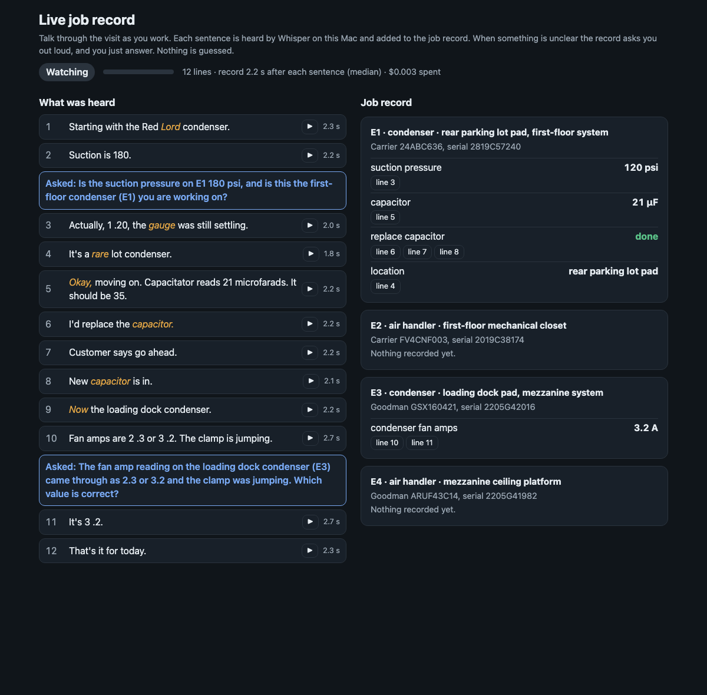

# field-voice-reliability

Hands-free capture for field service: a technician talks while working on several pieces of equipment, and the
system keeps a structured job record as they go. Each reading lands on the right unit, corrections and moved readings
are applied, approved work stays apart from finished work, and every value links back to the words and audio it came
from. When something is unclear it asks one short question instead of guessing.

Everything runs on one Mac. Results come from scripted visits voiced by text to speech with noise mixed in, one visit
read aloud by a person, and a few live microphone sessions. It is a bench test of the approach, not a field result.

**Demo:** [visit replay and results](https://yashgix.github.io/field-voice-reliability/live/). The hosted page replays
saved runs, line by line, with the record next to the transcript and the audio behind every value. It makes no model
calls. Live mode (below) runs only on a Mac.

## What is in the repository

| Part | Folder | What it does |
|---|---|---|
| Speech to values | `fvr/` | Local Whisper (large-v3-turbo through `mlx-whisper`) with the job record as context, a parser for spoken numbers and trade units, a reading checker that accepts a value or asks one targeted question, and the evaluation that measured them |
| Capture app | `mvp/` | A local web app for one visit: hold to talk, one reading at a time, targeted questions, a one-value-at-a-time read-back, and an append-only, hash-chained event log with the audio behind every value ([docs/MVP.md](docs/MVP.md)) |
| Live job record | `live/` | A language model updates the whole record after every spoken line of a multi-unit visit. A test bench scores it against the truth after every line ([live/README.md](live/README.md)), and live mode runs it hands-free from the microphone |
| Demo | `demo/` | The visit replay, generated from saved runs by `scripts/build_live_demo.py`, and the results page, written from the saved results |

How the parts fit: [docs/ARCHITECTURE.md](docs/ARCHITECTURE.md).

## Results in brief

- **Clear speech, 8 held-out visits:** the best live design (a model that re-reads the visit and keeps its own previous
  record) made 7 reasoning errors and never recorded unfinished work as done. A single read of the finished visit kept
  101 of 105 true facts.
- **Heavy background talk (0 dB):** every design kept only about half the facts. Most losses are words that never come
  through, not reasoning errors. Asking recovered a few lost values.
- **Job context helps recognition:** exact model numbers rose from 65% to 97% in the speech tests, and measurement
  words from 37 to 48 of 70 on the same noisy audio.
- **On a real human voice** (one speaker, held out): the reading checker cut readings lost without a question from
  35.4% to 14.6%, asking on 28% of utterances. No wrong value was accepted in either case.
- **Live mode, one visit read aloud in three rooms (quiet, music, an air duster)** and played into the server from the
  recording: the record updated about 3.5 s after the speaker stopped. With the final setup it kept 6 of 9 facts in
  both runs, one wrong entry each, at about $0.015 per visit at the listed API price. Every run is listed in
  [results/live/live-mode/README.md](results/live/live-mode/README.md).

Details, method and limits: the results page (`demo/live/results.html`) and [docs/FINDINGS.md](docs/FINDINGS.md).

## Live mode

The technician allows the microphone, clicks Start, and then just talks.

1. The page measures the room for two seconds, then cuts speech into sentences at pauses. It keeps re-measuring the
   room, so a microphone that is still adjusting its gain does not hide soft speech.
2. Each sentence is saved with its audio to the append-only event log and heard by local Whisper with the job's
   equipment list as context (about 1 s).
3. Claude Haiku updates the whole record from the visit so far and its own previous record (about 1.6 s, thinking off).
   Sentences queue in order, so nothing is lost while the model works.
4. If a reading cannot be settled, the page asks one question out loud and pauses listening while it speaks. Talking
   clearly over it stops it. A question is asked only about a reading the record marks unsettled, and never twice.
5. The record shows unsettled items as "not settled, will not guess". Every value links to the audio of its lines.



### Try live mode yourself

**You need:** an Apple Silicon Mac (M1 or later; other systems below), Python 3.12 with [uv](https://docs.astral.sh/uv/), Chrome, an
[Anthropic API key](https://console.anthropic.com/), about 2 GB of free disk, and ideally headphones.

1. Get the code and install it:
   ```sh
   git clone https://github.com/yashgix/field-voice-reliability.git && cd field-voice-reliability
   uv sync --extra dev --python 3.12
   ```
2. Put your API key in a `.env` file in the repository folder. It is git-ignored and read only by `live/api.py`:
   ```sh
   echo 'ANTHROPIC_API_KEY=your-key' > .env
   ```
3. Start the server. The first start downloads the Whisper model (about 1.6 GB) from Hugging Face, so give it a few
   minutes. It then prints a `localhost` link with a one-time token:
   ```sh
   uv run python -m live.server
   ```
4. Open the link in Chrome, click **Start the visit** and allow the microphone. Stay quiet for two seconds until the
   label turns green and says **Listening**.
5. Talk through a visit on the four units listed on the page, with a short pause after each sentence. For example:
   - "Starting with the rear lot condenser. Suction is one eighteen."
   - "Actually one twenty, the gauge was still settling."
   - "I'd replace the capacitor." Then "Customer says go ahead." Then "New capacitor is in."
   - "Now the loading dock condenser. Fan amps are two point three or three point two, the clamp is jumping."
     The page asks which one out loud. Answer "three point two".
6. Click **End the visit**. Each sentence appears on the left within a few seconds and the record fills in on the
   right. The event log and the audio are kept in `~/field-voice-data/live-mode/`.

A visit costs about $0.015 at the listed price of Claude Haiku. Every call's cost is added to a ledger in the data
folder, and calls stop once $8 is spent (`CAP_DOLLARS` in `live/api.py`). To use a different job, pass another visit
file's equipment list with `--visit`, for example `--visit live/scenarios/test/c01.json`.

**Other operating systems:** only speech recognition is Mac-specific (`mlx-whisper` needs Apple Silicon). On Linux,
Windows or an Intel Mac, `fvr/asr.py` uses `faster-whisper` instead, which the install step adds on those systems and
which downloads its own copy of the model on first use. The server, the page and the model calls are plain Python and
browser code. The Apple Silicon path is the tested one; the `faster-whisper` path is written but not yet tested.

`live/feed.py` plays a recorded visit into the server at speaking pace and scores the record, and the page's voice
detector has its own tests (`tests/listener.test.mjs`).

## Setup and checks

```sh
uv venv --python 3.12 .venv && uv pip install -e '.[dev]'
uv run pytest                                # Python tests, plus the voice detector's tests if Node is installed
uv run ruff check . && uv run ruff format --check .
```

Models and datasets are downloaded to a data folder outside the repository ([DATA.md](DATA.md)). The live test bench
calls a model through the Claude Code command line on a subscription login, with a hard cap on calls, and refuses to
run if an API key would be used (`live/model.py`).

## Reproduce the measurements

```sh
# speech to values (local, about 1.5 h on an M4 Pro)
PYTHONPATH=. python scripts/prepare_synth.py
scripts/run_all.sh
PYTHONPATH=. python scripts/analyze.py results/synthetic

# live job record, 8 held-out visits, clear and noisy (about 1,800 model calls)
uv run python -m live.render live/scenarios/test/[cg]0?.json --split test
uv run python -m live.run results/live/stage1 live/scenarios/test/[cg]0?.json --split test --conditions gold,asr --max-calls 2000
uv run python -m live.report results/live/stage1 live/scenarios/test/[cg]0?.json --disputed live/scenarios/test/disputed.json

# the replay page
uv run python scripts/build_live_demo.py && cd demo && python3 -m http.server 8765   # http://127.0.0.1:8765/live/
```

## Limits

- Synthetic voices and scripted visits. 0 dB babble is a stress test, not a typical site.
- 8 held-out visits, one run each, one small model at low effort. Live mode was tried by one speaker on one laptop.
- The visit scripts were written by two independent language-model authors from a neutral specification
  ([live/SPEC.md](live/SPEC.md)) and every label was re-checked blind. A field result needs real technicians'
  recordings.
- Whisper still mishears some spoken numbers ("one eighteen" as 180). The record asks rather than guesses, but a
  misheard number that looks normal can still be saved.

## Layout

`fvr/` speech library, `mvp/` capture app, `live/` live record, live mode and test bench, `scripts/` data
preparation, runs, analysis and page builder, `results/` saved runs and tables, `demo/` pages and audio, `docs/`
method and findings, `tests/` tests.

This repository is a single-commit export of a longer research history. Commit ids in `results/*/FROZEN.txt` and in
some result files refer to that history.

## License

MIT. The dataset notices in [DATA.md](DATA.md) apply to anything derived from those datasets.
